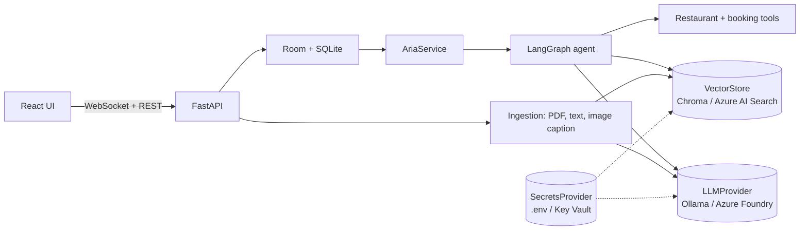

# Aria: a group chat with an AI agent as a member

A real-time group chat where an AI agent is a participant. Aria answers `@mentions`, answers questions
about uploaded PDFs, text files and images **with citations** (multimodal RAG), summarizes the
conversation, occasionally suggests things unprompted, and books restaurant tables (mocked, but fully
functional) **only after a human clicks Approve**.

Runs entirely on a laptop with local models (Ollama, Chroma, SQLite), and on Azure by changing
configuration (AI Foundry, AI Search, Key Vault, App Service, Static Web Apps).

## Demo

_Add a 2-minute demo video or GIF here._

## Architecture



## What makes it interesting

- **Agent as a chat member:** it decides *when* to speak (mention, or proactive with cooldown) and *what*
  to do (router + skills graph in LangGraph).
- **Human-in-the-loop actions:** booking pauses the graph with `interrupt()`; an Approve/Cancel card in the
  chat resumes it. Nothing is written before approval; double clicks are ignored.
- **Multimodal RAG with citations:** PDFs by page, text, and images (vision model caption + OCR text, then embedded).
- **Provider adapters:** one codebase, two environments; switching embedding models is handled
  (`reindex_all`).
- **Measured, not guessed:** an eval harness scores routing, proactive decisions and retrieval per model
  ([`docs/EVAL.md`](docs/EVAL.md)).
- **Built for small models:** one narrow structured decision per step, safe fallbacks, one model call at a time.

## Quick start (local, no cloud cost)

See [`docs/LOCAL_SETUP.md`](docs/LOCAL_SETUP.md). In short:

```bash
ollama serve                                   # with the models pulled
cd backend && pip install -r requirements-local.txt -r requirements-dev.txt
cp ../.env.example ../.env
uvicorn app.main:app --reload                  # terminal 1
cd frontend && npm install && npm run dev      # terminal 2 -> http://localhost:5173
```

Open two browser windows, join with different names, attach a PDF, then try:
`@Aria what does the leave policy say?`, `@Aria summarize`, `@Aria find us a cheap italian place`,
`@Aria book Bella Notte for 4 at 8pm`.

## Tests and evaluation

```bash
cd backend && pytest -q && ruff check .        # 89 tests, no network or models needed
python -m eval.run --provider ollama           # routing, proactive, retrieval scores
```

## Deploy to Azure

[`docs/DEPLOY_AZURE.md`](docs/DEPLOY_AZURE.md) and `scripts/deploy_azure.sh`.

## Repo guide

| Path | What |
|---|---|
| `backend/app` | FastAPI app, agent, tools, ingestion, providers |
| `backend/tests`, `backend/eval` | Tests (fakes only) and the model eval harness |
| `frontend/src` | React UI (`useChat.ts` owns the socket) |
| `docs/` | HLD, LLD, generated CODEMAP, setup, deploy, agent workflow, milestones, eval |
| `CLAUDE.md`, `AGENTS.md`, `.continue/rules` | Instructions for Claude Code, OpenCode, Continue |

## Limitations

Single backend instance; no authentication; pending confirmations are lost on restart; plain vector
search (no hybrid/rerank yet); scanned PDFs without a text layer are rejected. See HLD section 8.

## Design decisions and results

_Add after you run the eval: local 4B vs hosted model table, and what you changed to improve it._
