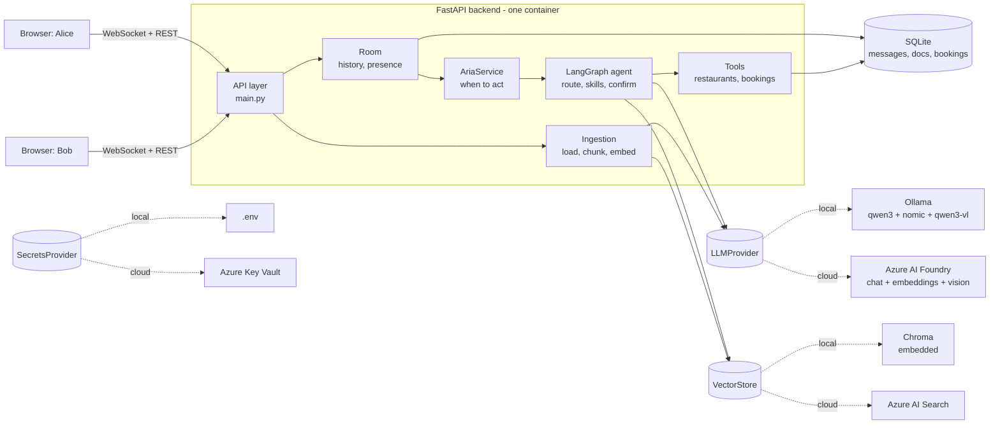
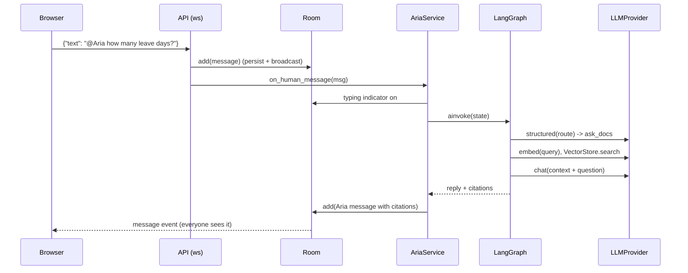
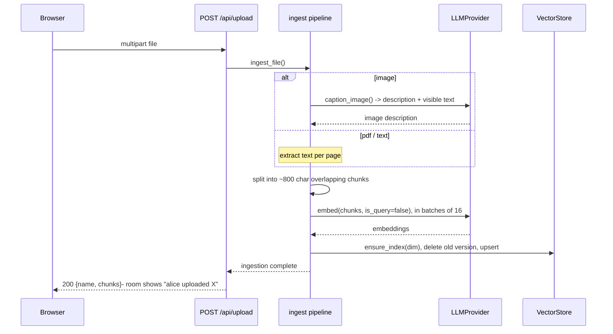
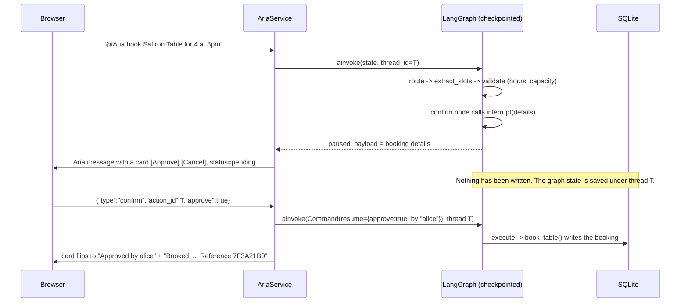
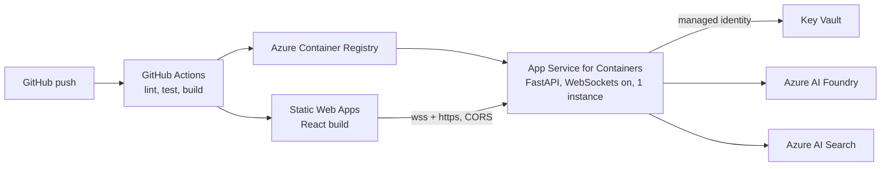

# High-level design (HLD)

## 0. The mental model in five lines

1. Browsers talk to one FastAPI server over a **WebSocket**. The server keeps a single chat **room**.
2. Every human message is shown to everyone. If it says **@Aria**, or the room has gone quiet-but-chatty,
   the **AriaService** wakes up.
3. AriaService runs a **LangGraph** state machine: a *router* picks a skill (answer from documents,
   summarize, suggest restaurants, book a table, or just chat).
4. Skills call **providers** (LLM, vector store, secrets) through interfaces, so the same code runs on
   Ollama + Chroma on your laptop and on Azure Foundry + Azure AI Search in the cloud.
5. Anything with a side effect (booking) **pauses for a human click** before it happens.

## 1. Goals and non-goals

| Goals | Non-goals (for the MVP) |
|---|---|
| Group chat where an AI is a real participant | Real user accounts / OAuth |
| Multimodal RAG with citations (PDF, text, image) | True multimodal embeddings (we caption images, then embed the text) |
| Agent with tools and human-in-the-loop approval | Multiple rooms, horizontal scaling |
| Runs fully local on an 8 GB Mac at zero cost | Real restaurant/booking APIs (mocked, but functional) |
| One-config switch to Azure (Foundry, AI Search, Key Vault) | Streaming token-by-token replies |

## 2. System context

## 3. Components

| Component | Responsibility | Where |
|---|---|---|
| React UI | Join screen, message list, citations, approve/cancel card, file upload | `frontend/src` |
| API layer | WebSocket endpoint, `/api/upload`, `/api/documents`, `/api/bookings`, CORS | `backend/app/main.py` |
| Room | Connected users, history, broadcast, persistence of messages | `backend/app/chat/room.py` |
| AriaService | Decides *when* Aria acts (mention vs proactive), runs the graph, posts results, resumes paused runs | `backend/app/agent/service.py` |
| Agent graph | Decides *what* Aria does: routing, retrieval, summarising, slot extraction, confirmation, execution | `backend/app/agent/graph.py` |
| Tools | Restaurant search and the mock booking action | `backend/app/tools/` |
| Ingestion | PDF/text/image to chunks to embeddings to vector store | `backend/app/ingest/` |
| Providers | Interfaces plus implementations for LLM, vector store, secrets | `backend/app/providers/` |
| Database | SQLite for messages, documents, bookings | `backend/app/db.py` |
| Eval harness | Measures routing, proactive decisions and retrieval per model | `backend/eval/` |

## 4. Key flows

### 4.1 A message that mentions @Aria

### 4.2 Uploading a document or image

### 4.3 Booking with human-in-the-loop (the interesting one)

A second click on the same card is ignored: the pending entry is removed on first use.

### 4.4 Aria speaking up unprompted

After every 4th non-mention human message (and at most once per 90 s, and never while a confirmation is
open), `decide_offer` asks the model one narrow question: *offer restaurants, offer a summary, or stay
silent?* It never invents content: "restaurants" runs the real search tool; "summary" posts a fixed
invitation. Silence is the default.

## 5. Deployment views

| Concern | Local (laptop) | Azure (live demo) |
|---|---|---|
| Chat / routing model | Ollama `qwen3:4b` | Foundry chat deployment (gpt-4o-mini class) |
| Embeddings | Ollama `nomic-embed-text` (768-d) | Foundry `text-embedding-3-small` (1536-d) |
| Image captioning | Ollama `qwen3-vl` 2B | Same Foundry chat deployment (vision-capable) |
| Vector store | Chroma, embedded in-process | Azure AI Search index |
| Secrets | `.env` | Key Vault, read via managed identity |
| Messages / bookings | SQLite file | SQLite on App Service `/home` (persistent storage) |
| Backend runtime | `uvicorn --reload` | Docker image in ACR, run by App Service for Containers |
| Frontend | Vite dev server | Azure Static Web Apps (static build) |

The browser connects to the App Service URL directly for WebSockets (Static Web Apps does not proxy
them), so `VITE_API_URL` points at the backend and `CORS_ORIGINS` lists the static site.

## 6. Design decisions and trade-offs

| Decision | Why | Cost / alternative |
|---|---|---|
| **Provider interfaces** (`LLMProvider`, `VectorStore`, `SecretsProvider`) | Same code on laptop and Azure; trivially fakeable in tests; clean interview story | A thin abstraction layer to maintain |
| **Router + skills graph**, not a free-form tool-calling loop | A 4B local model is unreliable at open-ended tool loops; one narrow structured decision per node is dependable and measurable | Less "autonomous". `LLMProvider.chat` already accepts tools, so a ReAct node can be added for stronger models |
| **LangGraph `interrupt()`** for approval | Real pause/resume with checkpointed state, no hand-rolled state machine | Paused runs live in process memory (`MemorySaver`); a restart drops pending cards |
| **Caption-then-embed** for images | One embedding space, works with any text embedder, cheap | Loses visual detail the caption misses; true multimodal embeddings are a later upgrade |
| **Structured JSON output with `""`/`0` as "unknown"** | Small models and grammar-constrained decoding handle it better than null | Slightly unusual schemas |
| **One model call at a time** (`model_lock`) | 8 GB machines cannot serve parallel generations; uploads and Aria share the lock | A long upload delays replies |
| **SQLite** | Zero setup, single file | Not multi-instance. Cosmos DB / Postgres is the upgrade path behind `db.py` |
| **Single backend instance** | Room and presence are in memory | Scale-out needs Redis pub/sub or Azure Web PubSub |
| **Embedding dim differs per backend** | Different models | Index creation refuses a dim mismatch; `reindex_all` re-embeds stored uploads |

## 7. Non-functional notes

- **Latency:** a local 4B reply takes seconds, so the typing indicator is the UX answer. Hosted models answer
  in about a second.
- **Memory (8 GB Mac):** only one Ollama model loaded at a time (`OLLAMA_MAX_LOADED_MODELS=1`); embed in
  batches of 16; Chroma runs in-process; no Docker during development.
- **Cost:** local is free. Cloud cost is dominated by App Service (B1) and Azure AI Search tier; LLM tokens
  are cents at demo traffic. Set a budget alert. Check current prices before committing.
- **Security:** secrets only via `SecretsProvider`; Key Vault with managed identity in cloud; upload names
  are stripped of paths, size-capped (10 MB) and extension-allowlisted; the chat is name-only with no auth,
  so treat the demo URL as public and do not upload anything sensitive.
- **Reliability:** if the model is unreachable Aria says so instead of failing; invalid model JSON falls
  back to plain chat; double-clicks on Approve do not double-book.
- **Observability (next):** structured logs exist for agent failures; add OpenTelemetry or LangSmith-style
  tracing during polish.

## 8. Known limitations (honest list for the README)

- Pending confirmations are lost on restart (in-memory checkpointer).
- No authentication; names are not identities.
- Retrieval is plain vector search (no hybrid search or reranking yet); the small eval set measures it.
- Scanned PDFs without a text layer are rejected (OCR is a later step; images already go through the
  vision model).
